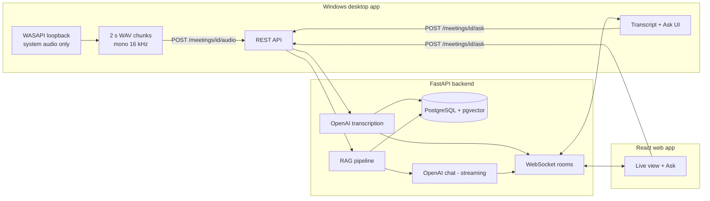

# Architecture

## Flow
1. Desktop user signs in, **Start meeting** creates a `meeting` with an 8-char code. The join URL `WEB_APP_URL/join?code=CODE` is shown as text and QR.
2. The desktop connects to `/ws/meetings/{id}` and starts WASAPI loopback capture. Every 2 s a mono 16 kHz WAV is uploaded (silent chunks are skipped; chunk index keeps offsets correct).
3. Backend transcribes (OpenAI, server-side key), stores a `transcript_segment`, runs question detection, stores `detected_questions`, and broadcasts `transcript.segment` / `question.detected`.
4. Web user signs in, enters the code or scans the QR (`POST /meetings/join` → participant row), opens the WebSocket and receives a `session.snapshot` followed by live events.
5. Either client sends a question (`POST /meetings/{id}/ask`). The backend embeds the query, runs pgvector cosine search over the workspace's ready document chunks, adds the last ~180 s of transcript, builds a grounded prompt, and streams tokens: `answer.started` → `answer.sources` → `answer.delta`* → `answer.completed`. All clients in the room receive the same stream.

## Security / access control
- JWT bearer auth; passwords hashed with bcrypt. WebSocket authenticates with `?token=`.
- Workspace members: full access (documents, audio streaming, ending meetings). Meeting code joiners: read + ask only, and only for that meeting.
- Document retrieval is always filtered by the meeting's `workspace_id`.
- OpenAI key exists only in backend env. Uploads: extension allow-list, size cap, random on-disk names.

## Scaling notes
`realtime/manager.py` is in-process. For multiple backend instances replace `broadcast` with Redis pub/sub. Document ingestion uses FastAPI background tasks; move to a queue (Celery/RQ) for heavy load.
