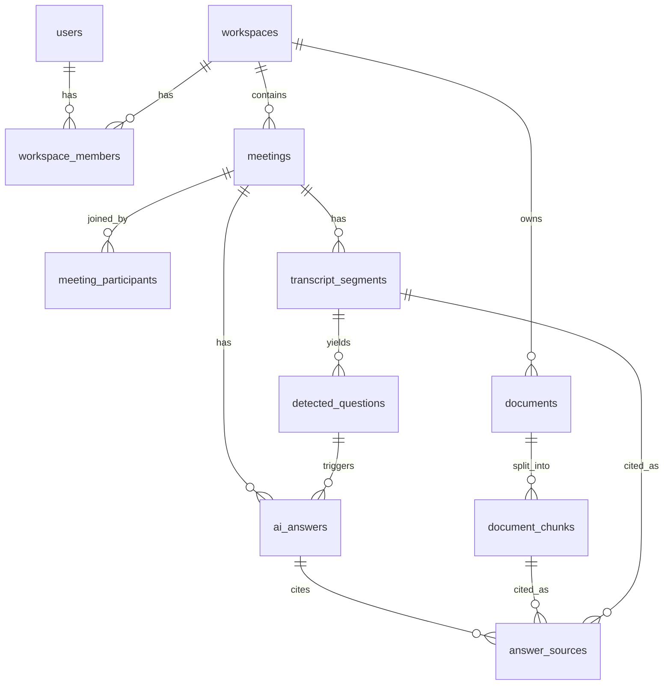

# Database design

PostgreSQL 15+ with the `vector` extension. Migration: `backend/migrations/versions/0001_initial.py`. All PKs are UUID.

| Table | Key columns |
|---|---|
| users | email (unique), full_name, password_hash, is_active |
| workspaces | name, owner_id |
| workspace_members | workspace_id, user_id, role (owner/admin/member), unique(workspace,user) |
| meetings | workspace_id, created_by, title, code (unique, 8 chars), status (live/ended), started_at, ended_at |
| meeting_participants | meeting_id, user_id (users who joined by code) |
| transcript_segments | meeting_id, chunk_index, start/end_offset_ms, text, is_question; unique(meeting, chunk_index) |
| detected_questions | meeting_id, segment_id, text, confidence |
| documents | workspace_id, uploaded_by, filename, storage_path, size_bytes, status (pending/processing/ready/failed), error |
| document_chunks | document_id, workspace_id, chunk_index, page_number, content, **embedding vector(1536)** |
| ai_answers | meeting_id, asked_by, question_id, question_text, context_text, answer_text, model, status |
| answer_sources | answer_id, source_type (document/transcript), chunk_id, segment_id, label, offset_ms, score, snippet |

Embeddings are stored on `document_chunks.embedding`, with an HNSW cosine index (`vector_cosine_ops`). If you change `EMBEDDING_DIMENSIONS`, change it in the migration too (or add a new one).
Deleting a document cascades to its chunks; answer sources keep their `snippet`/`label` (FK set to NULL).
